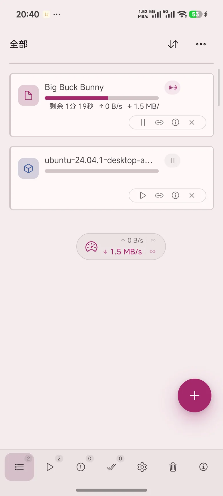
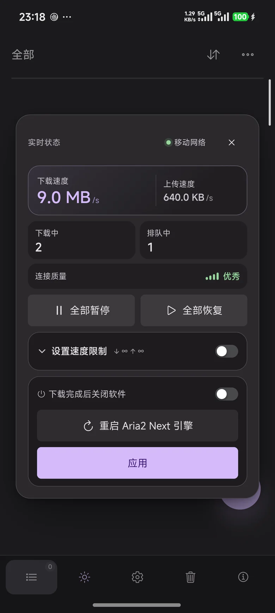
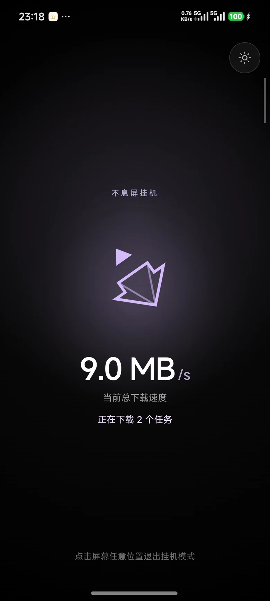
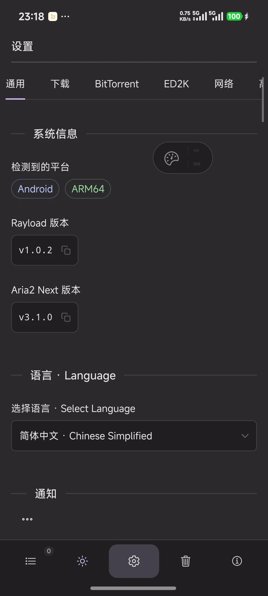

<div align="center">


# Rayload

> 🚀 致力于打造 Android 平台最纯粹、极速、可定制的开源下载器。无广告，无遥测，由极客打造，为极客服务。
>
> 🚀 Building the purest, fastest and most customizable open-source downloader
> for Android. No ads, no telemetry — built by geeks, for geeks.

**A fast, private Android downloader for HTTP, BitTorrent, Magnet and ED2K.**

Built on Aria2 Next with a mobile-first interface, background downloads,
share-to-download, a floating speed dashboard and a keep-awake mode.

[](https://github.com/shiwushuifeng/Rayload/releases/latest)


[**Download APK**](https://github.com/shiwushuifeng/Rayload/releases/latest) ·
[Why Rayload](#why-rayload) · [Screenshots](#screenshots) · [Roadmap](ROADMAP.md) ·
[Build](#build-from-source) · [简体中文](#简体中文)

</div>

<!-- language-selector:start -->
<details>
<summary>🌐 Language / 语言 / 語言 / Язык</summary>

[**English + 简体中文**](README.md) · [简体中文 · Chinese Simplified](docs/README.zh-CN.md) · [繁體中文 · Chinese Traditional](docs/README.zh-TW.md) · [日本語 · Japanese](docs/README.ja.md) · [한국어 · Korean](docs/README.ko.md) · [Français · French](docs/README.fr.md) · [Deutsch · German](docs/README.de.md) · [Español · Spanish](docs/README.es.md) · [Português · Portuguese (Brazil)](docs/README.pt-BR.md) · [Русский · Russian](docs/README.ru.md) · [Türkçe · Turkish](docs/README.tr.md) · [العربية · Arabic](docs/README.ar.md) · [Български · Bulgarian](docs/README.bg.md) · [Català · Catalan](docs/README.ca.md) · [Ελληνικά · Greek](docs/README.el.md) · [فارسی · Persian](docs/README.fa.md) · [Magyar · Hungarian](docs/README.hu.md) · [हिन्दी · Hindi](docs/README.hi.md) · [Bahasa Indonesia · Indonesian](docs/README.id.md) · [Italiano · Italian](docs/README.it.md) · [Norsk Bokmål · Norwegian](docs/README.nb.md) · [Nederlands · Dutch](docs/README.nl.md) · [Polski · Polish](docs/README.pl.md) · [Română · Romanian](docs/README.ro.md) · [ไทย · Thai](docs/README.th.md) · [Українська · Ukrainian](docs/README.uk.md) · [Tiếng Việt · Vietnamese](docs/README.vi.md)

</details>
<!-- language-selector:end -->

## 📚 Documentation

New to Rayload? Start with the quick start, then open the guide for your setup.

| Guide | What you will find |
| --- | --- |
| 🚀 [Quick Start](./docs/QUICK_START.md) | Install the right APK, grant permissions and run your first download. |
| 🌐 [LAN Networking](./docs/LAN_GUIDE.md) | Mutual pairing, QR and LAN discovery, cross-device tasks and live statistics. |
| 🔌 [Plugin Development](./docs/PLUGIN_DEVELOPMENT_GUIDE.md) | JSON parsing rules, network whitelists, header rewrites and the `{{password}}` variable. |
| 💻 [CLI Manual](./docs/HEADLESS_CLI.md) | Headless NAS/server deployment, YAML configuration and the full `ray` command set. |
| ❓ [FAQ](./docs/FAQ.md) | Slow downloads, pairing failures, denied permissions and link parsing errors. |
| 📱 [Android Notes](./docs/ANDROID.md) | Build variants, signing identities and Android-specific behavior. |
| 🗺️ [Roadmap](ROADMAP.md) | Planned features and engineering direction. |

## ⚠️ Disclaimer (免责声明)

> **English:** Rayload is a purely technical download tool. It does not provide,
> host, or distribute any copyrighted content. Users are solely responsible for
> ensuring their downloads comply with local laws and copyright regulations.
>
> **中文：** 本项目仅供技术交流与学习，请勿用于任何商业用途或非法下载。
> Rayload 仅提供 P2P/HTTP 下载技术，不存储、不提供、不分发任何下载资源内容；
> 用户应确保所下载内容拥有合法版权，并自行承担相关法律责任。

## Screenshots

<table>
  <tr>
    <td align="center"><br /><sub>Seamless task list with progress and quick actions</sub></td>
    <td align="center"><br /><sub>Floating live dashboard, limits and bulk controls</sub></td>
  </tr>
  <tr>
    <td align="center"><br /><sub>Keep-awake dashboard with live speed and task count</sub></td>
    <td align="center"><br /><sub>Android-first settings and 27 interface languages</sub></td>
  </tr>
</table>

## Why Rayload

- **One downloader for every link.** HTTP/HTTPS, FTP, BitTorrent, magnet links,
  Metalink and ED2K run through the same Aria2 Next engine.
- **Designed for phones, not ported from desktop.** Share links from any
  browser, download in the background, and control everything from a floating
  speedometer or the foreground notification.
- **Private by design.** No account, no telemetry and no cloud relay. The local
  Aria2 JSON-RPC endpoint is authenticated and bound to the device.
- **Made to fit your workflow.** Infinite task list, full/compact cards, speed
  limits, scheduled limits, file selection, task trash, themes and a
  customizable bottom navigation.

## Vision

Rayload aims to be the most focused, fastest and most customizable open-source
downloader on Android. We are building a downloader that stays private by
default, runs every protocol through one reliable engine, feels native on a
phone, and grows through themes and plugins without losing its simplicity. See
the [roadmap](ROADMAP.md) for what comes next.

## v1.0.4 Highlights

- Mutual LAN pairing: both devices confirm the peer and fingerprint, store each
  other, and can push tasks or view live statistics in either direction.
- Remote tasks from paired devices appear in the task list with pause, resume
  and remove actions, including an offline fallback state.
- Statistics gained “This device” and “All devices” tabs with per-peer live
  speed and active-task counts.
- Declarative JSON plugins now run behind a permission-checked sandbox with
  risk-graded consent, domain allow-lists and forced header stripping.
- A rebuilt `ray` CLI turns any Linux NAS or server into a headless download
  console with YAML config, daemon mode, systemd and task control.
- Separate lite, full and F-Droid builds; the F-Droid variant uses its own
  application ID and ships no GitHub self-update path.

## Features

### Downloads

- Multi-protocol engine: HTTP, HTTPS, FTP, BitTorrent, magnet, Metalink and ED2K.
- Pause, resume, retry and remove individual tasks; bulk pause and resume.
- Per-task speed limits plus scheduled global limits.
- BitTorrent file selection with select-all, independent scrolling and
  configurable download policy.
- Tracker management, peer blocklists, DHT, PEX, LPD and encrypted transport.
- SHA-256 verification and a recoverable file trash for downloaded files.

### Mobile experience

- Seamless infinite-scroll task list with full and compact display modes.
- Floating speedometer with live speeds, connection quality, task counts, bulk
  controls, limits and engine restart.
- Edge-docked speed chip that can be dragged back into the full capsule.
- Keep-awake dashboard with theme-aware logo, breathing glow, live speed and
  active task count; respects reduced-motion settings.
- Share-to-download from browsers and other apps, with files saved to the public
  `Download/Rayload` folder by default.

### Android integration

- Foreground download service with a localized persistent notification and
  working pause/resume actions.
- Native wake lock while downloading, optional screen-on keep-awake mode, and
  optional shutdown when all downloads finish.
- DocumentsUI folder picker, FileProvider sharing, all-files access guidance and
  battery-optimization guidance.
- Static gold launcher icon plus in-app theme palettes: gold, violet, blue and
  teal.

### Customization

- Light, dark and system appearance; keep-awake mode adds a quick light/dark
  toggle.
- Choose the app logo, launcher icon, card density and navigation entries.
- 27 interface languages with English as the schema fallback.

### Extensibility and headless

- Declarative JSON rule plugins parse share links, POST extraction codes and
  resolve CDN URLs without executing arbitrary code.
- Every capability is declared, risk-graded and explicitly granted by the user;
  the Rust host re-checks the grant intersection and host allow-list per request.
- Script plugins remain available for advanced cases, behind a high-risk warning.
- The `ray` CLI provides the same LAN API and Aria2 engine on Linux servers.

## Editions

| Edition | Artifact | Best for |
| --- | --- | --- |
| Lite (ARM64) | `Rayload-v1.0.4-lite-arm64.apk` | Phones and tablets that only need the core downloader; smallest install. |
| Full (ARM64) | `Rayload-v1.0.4-full-arm64.apk` | Devices that need mutual LAN pairing, remote tasks and the JSON plugin engine. |
| Full (x86_64) | `Rayload-v1.0.4-full-x86_64.apk` | x86_64 tablets, Android emulators and test devices. |
| F-Droid (ARM64) | `Rayload-v1.0.4-fdroid-arm64.apk` | Users who want F-Droid-managed updates; separate application ID, no GitHub updater. |
| CLI (Linux x86_64) | `rayload-cli-v1.0.4-linux-x86_64.tar.gz` | NAS, home servers and headless Linux boxes managed over SSH. |

The **Full** build is recommended for most users. Lite keeps the same download
engine but omits LAN pairing and the plugin engine.

## Installation

Download the latest ARM64 APK from
[GitHub Releases](https://github.com/shiwushuifeng/Rayload/releases/latest):

| Item           | Requirement                 |
| -------------- | --------------------------- |
| Minimum system | Android 7.0 / API 24        |
| Target system  | Android 17 / API 37         |
| Production ABIs | `arm64-v8a`, `x86_64`      |
| Application ID | `com.shiwushuifeng.rayload` |

Release artifacts:

| Artifact | Purpose |
| --- | --- |
| `Rayload-v1.0.4-lite-arm64.apk` | Lite ARM64 build (core downloader) |
| `Rayload-v1.0.4-full-arm64.apk` | Full ARM64 build with LAN and plugin engine |
| `Rayload-v1.0.4-full-x86_64.apk` | Full x86_64 build (x86 devices and emulators) |
| `Rayload-v1.0.4-fdroid-arm64.apk` | F-Droid ARM64 build with store-managed updates |
| `rayload-cli-v1.0.4-linux-x86_64.tar.gz` | Linux headless CLI (`ray`, `rayload` and YAML example) |
| `SHA256SUMS-v1.0.4.txt` | SHA-256 checksums for all release artifacts |

### Quick start

1. Download the latest APK from Releases and install it on an ARM64 or x86_64 device.
2. Grant all-files access and allow notifications so downloads can run in the
   background.
3. Tap **+** or share a link from any browser to start your first download.

For reliable long downloads, also allow battery-optimization exemption. The
default download folder is `/storage/emulated/0/Download/Rayload`.

Release APKs use the independent Rayload signing identity. Debug APKs use the
Android debug certificate; uninstall the other variant before switching between
them. Rayload does not target desktop platforms. Standard Chrome for Android
cannot load desktop extensions; use Firefox for Android or a Chromium build with
extension sideloading for browser integration.

## Browser RPC configuration

Rayload exposes an authenticated Aria2 JSON-RPC endpoint on the device:

```text
Address: http://127.0.0.1:6800/jsonrpc
Secret:  Settings → Advanced → RPC Secret
```

Install an extension compatible with Aria2 JSON-RPC in Firefox for Android or a
Chromium build that supports extension sideloading, then enter the address and
paste the RPC secret.

## Build from source

### Dependencies

| Tool        | Version or target                   |
| ----------- | ----------------------------------- |
| Node.js     | 22 or newer                         |
| pnpm        | `11.5.2`, matching `packageManager` |
| Rust        | stable with `aarch64-linux-android` |
| Java        | JDK 21                              |
| Android SDK | Platform 37 and Build Tools 37.0.0  |
| Android NDK | `29.0.14206865`                     |
| Git         | current stable                      |

```bash
rustup target add aarch64-linux-android

export JAVA_HOME=/path/to/jdk-21
export ANDROID_HOME=/path/to/android-sdk
export ANDROID_SDK_ROOT="$ANDROID_HOME"
export NDK_HOME="$ANDROID_HOME/ndk/29.0.14206865"

pnpm install
pnpm android:prepare
pnpm tauri android build --apk --target aarch64
```

Build a debug APK with `--debug`. Release signing is read from the local
`signing/keystore.properties` file; keystores and passwords are never committed.

### Headless CLI

The desktop/Linux build also ships `ray`, a terminal download console with
YAML config, daemon mode, task control and the LAN API. `rayload` and
`rayload-cli` remain compatibility names. See
[docs/HEADLESS_CLI.md](docs/HEADLESS_CLI.md) for the full command reference,
security check, environment variables and the non-root Docker image:

```bash
curl -fsSL https://raw.githubusercontent.com/shiwushuifeng/Rayload/main/scripts/install-cli.sh | sh
```

This installs `ray` and `rayload` into `~/.local/bin` without `sudo`. To build
from source instead:

```bash
cargo build --release --manifest-path src-tauri/Cargo.toml --features cli --bin ray
./src-tauri/target/release/ray security-check
```

The customized Android Studio project lives in `src-tauri/gen/android` and must
be preserved. Do not run `tauri android init` over it; that would replace
Rayload's share target, foreground service, DocumentsUI bridge and Kotlin entry
point.

### Quality checks

```bash
pnpm lint
pnpm format:check
pnpm check:repo
pnpm test
npx vue-tsc --noEmit
cargo test --manifest-path src-tauri/Cargo.toml --workspace --all-targets
```

## Project structure

### Architecture

```text
Vue 3 + Pinia + Naive UI
          │ Tauri IPC
Rust backend + native Android bridge
          │ JSON-RPC / process control
      Aria2 Next (arm64-v8a)
```

```text
src/                         Vue frontend
src-tauri/src/               Rust backend and native services
src-tauri/gen/android/       Customized Android Studio project
src-tauri/locales/           Native JSON translations
src/shared/locales/          Frontend JSON translations
scripts/android/             Android Kotlin source templates
docs/screenshots/            README screenshots
ROADMAP.md                   Product and engineering roadmap
```

## Troubleshooting and FAQ

### The notification has no pause or resume button

Allow notifications for Rayload, disable battery optimization, and reopen the
app once. Some customized Android ROMs also hide notification actions until the
foreground service is restarted.

### Downloads stop in the background

Exclude Rayload from battery and deep-sleep restrictions. Keeping the app open,
or using keep-awake mode while charging, helps on aggressive vendor ROMs.

### My browser cannot connect to the RPC endpoint

Chrome for Android cannot load desktop extensions. Use Firefox for Android or a
Chromium build that supports extension sideloading, then enter the address and
RPC secret from **Settings → Advanced**.

### "App not installed" appears when switching builds

Release and debug APKs use different signing identities. Uninstall the existing
version before installing the other variant.

More answers are in the [full FAQ](docs/FAQ.md).

## Contributing and support

- Found a bug or have a feature request? Open an issue with the app version,
  device model and reproduction steps.
- Pull requests are welcome for Android behavior, translations and documentation.
- If Rayload saves you time, a star helps other Android users find it.

## License and attribution

Rayload is licensed under the **GNU General Public License v3.0 only
(GPL-3.0)**. It is an independent, unofficial Android port based on
[Rayburst](https://github.com/AnInsomniacy/rayburst), created by
**AnInsomniacy** and licensed under the MIT License. The bundled Aria2 Next
(`aria2-next`) engine is licensed under **GPL-2.0-or-later**.

| Component | License |
| --------- | ------- |
| Rayload | GPL-3.0-only |
| Rayburst | MIT |
| aria2-next | GPL-2.0-or-later |

Copyright and license notices for all third-party components, including the
preserved Rayburst MIT text, are documented in [NOTICE](NOTICE). Rayload is
independently maintained and is not an official Rayburst release or endorsed by
the original author.

## Support

❤️ 喜欢这个项目？欢迎 [赞助与支持 (Sponsor)](./SPONSOR.md)

---

## 简体中文

<div align="center">

**极速、私密的 Android 下载器：HTTP、BitTorrent、Magnet、ED2K 一个应用全搞定。**

[**下载 APK**](https://github.com/shiwushuifeng/Rayload/releases/latest) ·
[功能](#功能亮点) · [截图](#截图) · [路线图](ROADMAP.md) · [编译](#从源码编译)

</div>

Rayload 是 Rayburst 的独立非官方 Android 移植版，仅专注于 Android 平台。
项目使用 Tauri、Rust、Vue 3 和 Aria2 Next 构建，提供移动端界面、系统分享、
后台下载、通知、公共下载目录集成以及本地 Aria2 JSON-RPC 服务。

### 📚 文档导航 (Documentation)

第一次使用 Rayload？先看快速上手，再按使用场景打开对应指南。

| 文档 | 内容简介 |
| --- | --- |
| 🚀 [快速上手](./docs/QUICK_START.md) | 选择正确的安装包、授予权限并完成第一个下载。 |
| 🌐 [局域网互联指南](./docs/LAN_GUIDE.md) | 双向配对、扫码与局域网发现、跨端任务推送与实时统计。 |
| 🔌 [插件开发指南](./docs/PLUGIN_DEVELOPMENT_GUIDE.md) | JSON 解析规则、网络白名单、请求头改写与 `{{password}}` 变量。 |
| 💻 [CLI 命令行手册](./docs/HEADLESS_CLI.md) | NAS/服务器无头部署、YAML 配置详解与 `ray` 命令全集。 |
| ❓ [常见问题](./docs/FAQ.md) | 下载慢、配对失败、权限被拒与链接解析失败。 |
| 📱 [Android 说明](./docs/ANDROID.md) | 构建变体、签名差异与 Android 平台特性。 |
| 🗺️ [路线图](ROADMAP.md) | 计划中的功能与工程方向。 |

### 项目愿景

打造 Android 平台上最纯粹、极速、可定制的开源下载器。坚持隐私优先，用一个
引擎处理所有协议，提供原生移动端体验，并通过主题与插件持续扩展。未来计划见
[路线图](ROADMAP.md)。

### v1.0.4 更新亮点

- 双向局域网配对：双方确认设备与指纹并互相保存，任意一方都能推送任务、
  查看实时统计。
- 任务列表汇总已配对设备的远程任务，支持暂停、继续与删除，并显示离线状态。
- 数据统计页新增“本机”与“全部设备”两个 Tab，展示各设备实时速度与活动任务数。
- 声明式 JSON 插件引入权限沙箱：风险分级授权、域名白名单与请求头强制剥离
  在 Rust 宿主内再次校验。
- 重构后的 `ray` CLI 让 Linux NAS/服务器变成无头下载控制台：YAML 配置、
  守护进程、systemd 与任务控制。
- 拆分为轻量版、完整版与 F-Droid 版；F-Droid 版使用独立包名，并彻底移除
  GitHub 自更新。

### 截图

<table>
  <tr>
    <td align="center"><br /><sub>无缝任务列表与快捷操作</sub></td>
    <td align="center"><br /><sub>悬浮实时状态、限速与批量控制</sub></td>
  </tr>
  <tr>
    <td align="center"><br /><sub>挂机页：实时速度与任务数</sub></td>
    <td align="center"><br /><sub>Android 优先的设置与 27 种语言</sub></td>
  </tr>
</table>

### 功能亮点

- **一个引擎下载所有链接**：HTTP/HTTPS、FTP、BitTorrent、磁力链、Metalink、ED2K。
- **为手机而生**：浏览器分享即下载、后台前台服务、通知栏暂停/继续、悬浮速度球与不息屏挂机。
- **隐私优先**：无账号、无遥测、无云端中转；本地 Aria2 JSON-RPC 带鉴权并仅绑定本机。
- **多端互联**：双向配对、指纹核对、跨端推任务与全部设备实时统计。
- **可扩展**：JSON 插件规则、分级权限授权、域名白名单，以及面向服务器的 `ray` CLI。
- **顺手好用**：无限滚动任务列表、完整/紧凑卡片、限速与定时限速、种子文件全选、回收站、主题与底部导航自定义。

### 发行版选择

| 发行版 | 产物 | 适用人群 |
| --- | --- | --- |
| 轻量版（ARM64） | `Rayload-v1.0.4-lite-arm64.apk` | 只需要核心下载功能、希望安装包更小的手机与平板。 |
| 完整版（ARM64） | `Rayload-v1.0.4-full-arm64.apk` | 需要双向局域网配对、远程任务与 JSON 插件引擎的用户；推荐大多数用户选择。 |
| 完整版（x86_64） | `Rayload-v1.0.4-full-x86_64.apk` | x86_64 平板、Android 模拟器与测试设备。 |
| F-Droid 版（ARM64） | `Rayload-v1.0.4-fdroid-arm64.apk` | 希望由 F-Droid 客户端管理更新；独立包名，不含 GitHub 自更新。 |
| CLI 版（Linux x86_64） | `rayload-cli-v1.0.4-linux-x86_64.tar.gz` | NAS、家庭服务器与通过 SSH 管理的无头 Linux 主机。 |

轻量版保留同一套下载引擎，但移除局域网配对与插件引擎。

### 安装

从 [GitHub Releases](https://github.com/shiwushuifeng/Rayload/releases/latest)
下载最新 ARM64 APK：

| 项目     | 要求                        |
| -------- | --------------------------- |
| 最低系统 | Android 7.0 / API 24        |
| 目标系统 | Android 17 / API 37         |
| 生产架构 | `arm64-v8a`、`x86_64`       |
| 应用包名 | `com.shiwushuifeng.rayload` |

发布附件：

| 附件 | 用途 |
| --- | --- |
| `Rayload-v1.0.4-lite-arm64.apk` | ARM64 轻量包（核心下载功能） |
| `Rayload-v1.0.4-full-arm64.apk` | 含局域网与插件引擎的 ARM64 完整包 |
| `Rayload-v1.0.4-full-x86_64.apk` | x86_64 完整包（x86 设备与模拟器） |
| `Rayload-v1.0.4-fdroid-arm64.apk` | F-Droid ARM64 包（由商店管理更新） |
| `rayload-cli-v1.0.4-linux-x86_64.tar.gz` | Linux 无界面 CLI（含 `ray`、`rayload` 与 YAML 示例） |
| `SHA256SUMS-v1.0.4.txt` | 全部发行产物的 SHA-256 校验值 |

#### 快速开始

1. 从 Releases 下载最新 APK，并安装到 ARM64 或 x86_64 设备。
2. 授予“所有文件访问权限”并允许通知，以便后台下载正常运行。
3. 点击 **+**，或从任意浏览器分享链接，开始第一个下载任务。

长时间下载建议同时授予电池优化豁免。默认下载目录为
`/storage/emulated/0/Download/Rayload`。

Release APK 使用 Rayload 独立签名，Debug APK 使用 Android 调试证书；两者签名
不同，切换安装前需要先卸载另一版本。

### 浏览器 RPC 配置

```text
地址：http://127.0.0.1:6800/jsonrpc
密钥：设置 → 高级 → RPC Secret
```

在 Firefox Android 或支持扩展侧载的 Chromium 浏览器中，安装兼容 Aria2
JSON-RPC 的扩展，填写上述地址，并粘贴设置页中的 RPC Secret。

### 从源码编译

```bash
rustup target add aarch64-linux-android

export JAVA_HOME=/path/to/jdk-21
export ANDROID_HOME=/path/to/android-sdk
export ANDROID_SDK_ROOT="$ANDROID_HOME"
export NDK_HOME="$ANDROID_HOME/ndk/29.0.14206865"

pnpm install
pnpm android:prepare
pnpm tauri android build --apk --target aarch64
```

调试包追加 `--debug`。Release 签名从本地 `signing/keystore.properties` 读取，
密钥库和密码不会提交到 Git。定制的 Android Studio 工程位于
`src-tauri/gen/android`，不要重新执行 `tauri android init`。

### 质量检查

```bash
pnpm lint
pnpm format:check
pnpm check:repo
pnpm test
npx vue-tsc --noEmit
cargo test --manifest-path src-tauri/Cargo.toml --workspace --all-targets
```

### 项目结构

```text
Vue 3 + Pinia + Naive UI
          │ Tauri IPC
Rust 后端 + Android 原生桥接
          │ JSON-RPC / 进程控制
      Aria2 Next (arm64-v8a)
```

```text
src/                         Vue 前端
src-tauri/src/               Rust 后端与原生服务
src-tauri/gen/android/       定制 Android Studio 工程
src-tauri/locales/           原生 JSON 翻译
src/shared/locales/          前端 JSON 翻译
scripts/android/             Android Kotlin 源模板
docs/screenshots/            README 截图
ROADMAP.md                   产品与工程路线图
```

### 常见问题

#### 通知栏没有暂停/继续按钮

请允许 Rayload 发送通知、关闭电池优化，并重新打开一次应用。部分定制
Android 系统还会在前台服务重启前隐藏通知操作按钮。

#### 后台下载会中断

请将 Rayload 排除在电池优化和深度睡眠限制之外。在限制较激进的部分系统上，
保持应用打开或充电时使用不息屏模式会更稳定。

#### 浏览器无法连接 RPC

Chrome for Android 不支持桌面扩展。请使用 Firefox Android 或支持扩展侧载的
Chromium 构建，并填写**设置 → 高级**中的地址与 RPC Secret。

#### 切换安装包时提示“应用未安装”

Release 与 Debug APK 使用不同的签名证书。安装另一个版本前，请先卸载当前版本。

更多问题与排查步骤见 [完整常见问题](docs/FAQ.md)。

### 参与与支持

- 遇到问题请提交 Issue，并附上版本号、设备型号与复现步骤。
- 欢迎提交 Android 行为、翻译与文档相关的 Pull Request。
- 如果 Rayload 对你有帮助，点一个 Star 能让更多 Android 用户发现它。

### 致谢与许可

Rayload 以 **GNU General Public License v3.0（GPL-3.0）** 分发，是
**AnInsomniacy** 创建的 [Rayburst](https://github.com/AnInsomniacy/rayburst)
（MIT 许可）的独立非官方 Android 移植版。内置的 Aria2 Next（`aria2-next`）
引擎按 **GPL-2.0-or-later** 许可分发。

| 组件 | 许可证 |
| ---- | ------ |
| Rayload | GPL-3.0-only |
| Rayburst | MIT |
| aria2-next | GPL-2.0-or-later |

三方组件的版权与许可证声明（包括保留的 Rayburst MIT 全文）见
[NOTICE](./NOTICE)。Rayload 由独立维护者发布，不是 Rayburst 官方版本，也不代表
原作者背书。

### 支持

❤️ 喜欢这个项目？欢迎 [赞助与支持 (Sponsor)](./SPONSOR.md)

---

## Star History

[](https://star-history.com/#shiwushuifeng/Rayload&Date)

<div align="center">

**⭐ If Rayload saves you time, give it a star — it helps more Android users find it.**

**⭐ 如果 Rayload 对你有帮助，请点一个 Star，让更多 Android 用户发现它。**

👉 [View the full roadmap](./ROADMAP.md) · [查看我们的完整开发路线图与未来目标 (Roadmap)](./ROADMAP.md)

</div>
